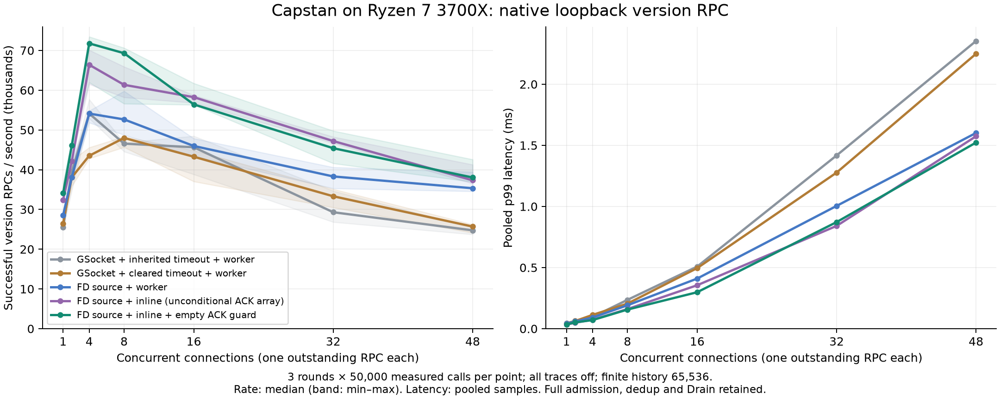

# Native concurrency and perf — latest measured configuration

Measured on 2026-11-05, Ryzen 7 3700X (8 cores / 16 threads), Linux x86_64,
GCC 16.2.1, GIO 2.90.1, libuv 1.53.0. C++14, `-O3 -DNDEBUG`, LTO,
`-march=native`, strict no-exceptions, FF fast runner and a dedicated UV worker.
Dependencies are exactly those in `deps.lock.json`. CPU power policy and affinity
were not changed; the desktop was not an isolated benchmark host.

At 32 concurrent connections the final configuration delivered **45,407
successful version RPC/s**, versus **29,298** for the reconstructed original
transport/worker control (**55.0% higher**). Pooled p99 fell
from **1.417 ms to 0.872 ms**. These are finite,
closed-loop batches on one object, not an absolute architectural limit.

## What was compared

All five configurations retain authentication, codec, grant/permission validation,
Lease checks, deduplication, admission pins, the serial execution lane and the
complete Close → Drain → Install barrier. Per-request traces are off in every
configuration. Both Host and native driver use the selected transport watches.

The GSocket controls are rebuilt from the current sources with only descriptor
watches reverted. The inherited-timeout control also retains the connector's
five-second data-socket timeout. Only the final configuration includes the empty
ACK-waiter fast return; the other four retain unconditional reply-array setup.
This is an explicit ablation experiment, not a comparison against untouched old
release binaries. All controls share the explicit C++ callback-publication fix.

Each version point has three 50,000-call batches and 1,000 warmups per batch.
Each summary point has three 512-call batches and eight warmups. The Dataset is
64 MiB, seed 7. A fresh Host is used for each batch, with history capacity 65,536;
no records are retired. One authenticated RPC is outstanding per connection.
Python only sets up and supervises the processes; the native driver generates
and validates each request. Setup, warmup and CSV output are outside timing.
Batch ramp-up/drain and driver scheduling/validation are inside timing.

Configuration order is shuffled deterministically within each concurrency point;
concurrency order changes across rounds. Rates below are **medians of batch
rates**; latency quantiles pool all three batches. Min/max batch rates are retained
in [report.json](report.json) and the shaded chart bands. Three rounds do not
establish statistical significance; short windows and desktop scheduling vary.

## Version RPC results

| Connections | Control RPC/s | Final RPC/s | Control p99, µs | Final p99, µs |
|---:|---:|---:|---:|---:|
| 1 | 25,462 | 34,065 | 43.77 | 35.08 |
| 2 | 39,517 | 46,106 | 64.42 | 51.89 |
| 4 | 54,119 | 71,770 | 96.52 | 70.59 |
| 8 | 46,556 | 69,305 | 235.96 | 156.44 |
| 16 | 45,641 | 56,419 | 508.18 | 298.36 |
| 32 | 29,298 | 45,407 | 1417.38 | 872.09 |
| 48 | 24,744 | 38,031 | 2353.62 | 1522.89 |

The highest median was **71,770 RPC/s at 4 connections**; its individual
batches ranged from **61,929 to 73,455 RPC/s**. Increasing
connections beyond the useful overlap point increases queueing; connections are
not additional object execution lanes.

| Configuration | 4 connections RPC/s | 8 connections RPC/s | 32 connections RPC/s | 48 connections RPC/s |
|---|---:|---:|---:|---:|
| GSocket, inherited timeout, worker | 54,119 | 46,556 | 29,298 | 24,744 |
| GSocket, cleared timeout, worker | 43,507 | 47,988 | 33,316 | 25,693 |
| Descriptor source, worker | 54,115 | 52,646 | 38,298 | 35,330 |
| Descriptor source, inline scalar | 66,392 | 61,346 | 47,202 | 37,325 |
| Descriptor source, inline scalar, empty ACK guard | 71,770 | 69,305 | 45,407 | 38,031 |

Clearing the inherited timeout is an explicit established-session policy fix;
its performance effect must be read from the two GSocket controls. It is not
interchangeable with replacing GSocketSource. The inline-only and final rows
isolate the empty ACK queue guard. No per-request logging speedup is claimed
from this comparison because logging is off throughout.

## Full 64 MiB summaries

Summary remains on the worker and scans the Dataset. It does not use the scalar
inline path. The table preserves variability instead of implying a scan-kernel
optimization from transport changes.

| Connections | Control median RPC/s (range) | Final median RPC/s (range) | Final p99, ms |
|---:|---:|---:|---:|
| 1 | 407 (406–408) | 408 (408–422) | 2.52 |
| 8 | 414 (411–416) | 418 (417–420) | 19.67 |
| 32 | 417 (411–418) | 413 (405–424) | 79.68 |

## Perf and remaining costs

Perf records Host and native driver only after warmup, using control-pipe ACKs
and driver gates. Twelve `cycles:u` records use 999 Hz sampling and 8 KiB DWARF
callchains. There are separate uninstrumented and `perf stat` windows. Perf
windows are not used for the throughput/latency tables above. The final perf
comparison holds descriptor watches and inline scalar placement constant and
changes only the empty ACK queue guard.

[Perf report](perf/report.json) retains per-thread CPU ticks and context switches;
[analysis](perf/analysis.json) retains DSO/self/inclusive sample periods, including
unresolved symbols. Every record has zero lost samples, and parsed callchain
counts match the exact sample counts in the flat reports. User-cycle percentages
are not wall-latency fractions or kernel-cost measurements. Inclusive percentages
overlap. Raw stack-memory recordings remain local; compressed symbolized flat reports (`perf/*/flat.txt.gz`) and
stat counters are included here.

The resolved `authority_replies::flush()` self share on the Host main thread
fell from 6.08% to no resolved self samples at eight connections, and from 7.95%
to 0.08% at 32 connections. In the single `perf stat` window per point, combined
Host + driver user instructions fell from 1.209 to 1.110 billion at eight
connections and 1.593 to 1.496 billion at 32 (20,000 RPCs each). These are sampled
shares/counter observations, not percentages of end-to-end latency saved.
The guard's throughput effect is not uniform: at 32 connections its median was
lower than the inline-only control, with overlapping run ranges. The report does
not claim a guaranteed throughput improvement from that final branch.

Across these scalar windows the worker has zero observed CPU ticks and zero
voluntary context switches. Work still passes through normal admission and
posted completion. On the load side, resolved samples concentrate in `ppoll`,
`recv`, `send` and GLib dispatch; Host samples include substantial unresolved
libc/GLib code. Those unknown samples are not attributed to guessed functions.
Transport/event-loop and response-processing costs remain, alongside one serial
execution lane. This does not show saturation of all 16 hardware threads.

## Verification and artifacts

All **5,273,040 measured RPCs across 150 batches** succeeded and
validated their results. Warmup errors were zero. Every batch retained identical
summary values and ended with admitted=completed, active=0. Publication rechecks
every raw CSV, sequence coverage, quantile, rate and current source fingerprint.

| Check | Passed tests |
|---|---:|
| 3700X GCC fast/strict | 36 |
| 3700X Clang fast/strict | 36 |
| 3700X GCC exceptions/normal runner | 37 |
| 3700X ASan + UBSan | 16 |
| 3700X TSan | 16 |
| Pi 4B GCC fast/strict | 36 |
| Unchanged nightly TLA+ suite | 2 safe models + 7 expected mutant counterexamples |

The new regressions cover established-connection idle time, cross-thread callback
publication, write/read FIFO and Drain ACK ordering in both execution modes,
history exhaustion across authority transfers, and native workload checks. CI
includes them in the full matrix and the 16-test sanitizer selection. The bounded
models are unchanged: execution placement does not change authority semantics.

- [All batch results and compressed raw-sample hashes](report.json); `raw/*.csv.gz`
  preserves completion order, sequence, slot, latency, outcome and validation.
- [Environment](environment.json), [source fingerprints](source-manifest.json),
  [validation](validation/report.json), and [pipeline results](pipeline.json).
- `methods/gcc-flags.make` and `methods/gcc-link.txt` preserve actual flags.
- `methods/build_reference.py` and `methods/final_compare.py` reconstruct the
  controls and run the experiment from the checkout root with a configured
  `build/`. Their publication copies use the current directory instead of the
  measured workspace's absolute path; recorded hashes identify the original
  scripts. Other path prefixes in logs are normalized.

For the supported benchmark CLI and policies, see
[performance.md](../../../docs/performance.md). Results are loopback, one-object,
closed-loop and finite-history measurements. They establish neither cross-machine
capacity nor indefinite service, open-loop p99, or an absolute architecture ceiling.
